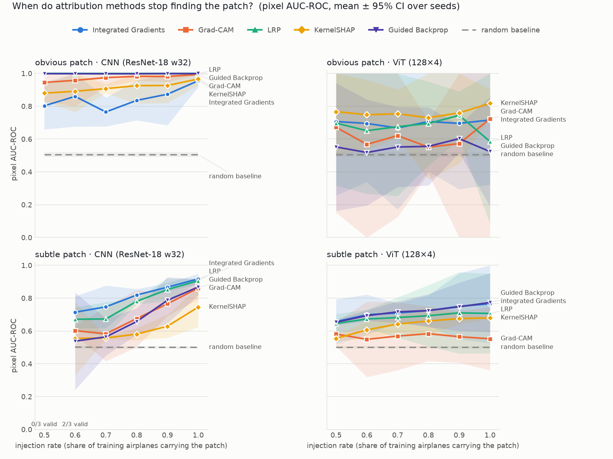
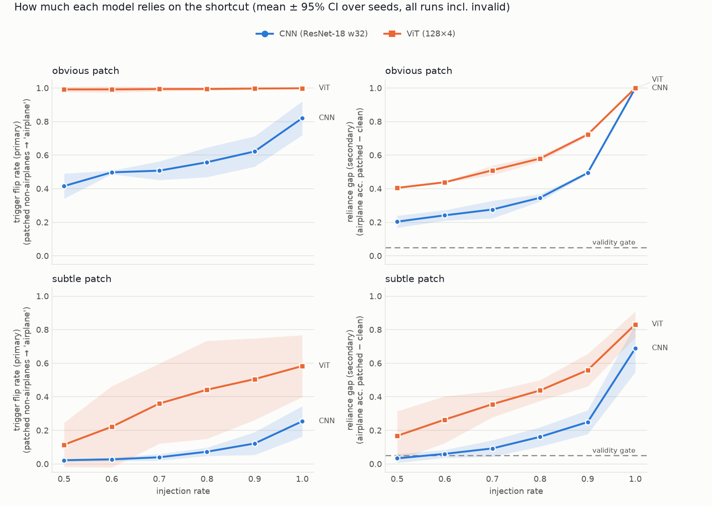

<h1 align="center">shortcut-xai-bench</h1>

<p align="center">
  <b>Do attribution methods detect a planted shortcut equally well in CNNs and Vision Transformers?</b>
</p>

<p align="center">
  
  
  
</p>

<p align="center">
  <a href="#key-findings">Key findings</a> ·
  <a href="#limitations">Limitations</a> ·
  <a href="#reproduce">Reproduce</a> ·
  <a href="#how-it-works">How it works</a> ·
  <a href="#results">Results</a> ·
  <a href="results/FINDINGS_LOG.md">Findings log</a>
</p>

> **TL;DR** The ViT relies on a planted shortcut *more* than the CNN, yet five standard attribution
> methods detect that reliance *less* (+0.23 vs +0.47 pixel AUC over a clean control, CNN ahead
> in 10/10 method × patch comparisons). A weak heatmap is not evidence of a shortcut-free model.

**Setup.** A small patch is planted on CIFAR-10 airplanes at a known location, so the ground-truth
mask is exact. Each model is checked to actually rely on the patch. Then six attribution methods are
scored on whether they point at it: Integrated Gradients, Grad-CAM, LRP, KernelSHAP, Guided
Backprop, and a random baseline.

| | |
|---|---|
| **Models** | ResNet-18 (2.8M params) vs a small ViT (0.55M params) |
| **Shortcuts** | obvious 4×4 magenta patch · subtle 8×8 blue-channel shift (+15) |
| **Grid** | 2 patch types × 6 injection rates (0.5–1.0) × 3 seeds × 2 models = 72 runs |
| **Control** | the same models trained without the patch, explained on the same patched images |
| **Primary measure** | Δ over the clean control: score on the shortcut model minus score on the clean model |

## Key findings

**1. The ViT relies on the shortcut more, yet attribution detects that reliance less.**
At injection rate 1.0, pixel AUC rises over the clean control by **+0.47 for the CNN but only
+0.23 for the ViT** (mean over 5 methods × 2 patch types × 3 seeds). The CNN's Δ is larger for
**all 5 methods on both patch types (10/10)**. In every one of those runs (6/6) the ViT relies on the
patch more.

> **What this implies about the tools:** how strongly a heatmap points at a shortcut reflects the
> architecture as much as the model's dependence on it. A weak attribution signal is not evidence
> of weak reliance. Attribution scores cannot be compared across architectures as a measure of
> shortcut use.

**2. Supporting evidence: the reliance comparison.** The ViT calls patched non-airplanes
"airplane" more often than the CNN in **30/30** paired runs (rates 0.5–0.9, both patch types).
Flip rate is defined for every run, so these counts and means include the 4 CNN runs that fail
the reliance gate.

| mean trigger flip rate, rates 0.5–0.9 | ViT | CNN |
|---|---|---|
| obvious patch | 99% | 52% |
| subtle patch | 33% | 6% |

This happens even though the ViT is the weaker classifier (accuracy on the unpatched test set,
mean over rates 0.5–0.9: 67% vs 83%). At rates 0.5–0.9 the CNN's mean Δ AUC is still larger at
every rate: 0.33–0.46 vs 0.19–0.25. Δ AUC needs heatmap scores, which exist only for runs that
pass the gate, so it uses only pairs where both models pass. Per method it is larger in 33/45
cells. The exceptions are obvious-patch LRP, where the CNN is capped (1.00 against a 0.77
control), and subtle-patch KernelSHAP.

**3. ViT Grad-CAM on the subtle patch has a negative Δ: −0.05 AUC.** It scores 0.61 on the clean
control vs 0.55 on the shortcut model (per seed −0.09, +0.02, −0.10). On a clean model there is
no reliance to find, so its 0.61 measures the patch's visual salience alone. Here the shortcut
model scores below that salience level.

<sub>Every number in this section can be read from [results/results.csv](results/results.csv)
(columns `trigger_flip_rate`, `acc_clean`, `auc`, `ctrl_auc`, `delta_auc`). The τ values under
Limitations come from [results/reduction_sensitivity.md](results/reduction_sensitivity.md).</sub>



*Raw pixel AUC of each method's heatmap against the patch mask, by injection rate (mean ± 95% CI
over 3 seeds). The random baseline (0.5) is a lenient floor: on clean-trained models most methods
score below 0.5 on this corner mask. That is why Δ over the clean control is the primary measure
(see "Sanity control" below).*

## Limitations

- **The method ranking depends on the channel-reduction rule, worst for the CNN's AUC.**
  We switched IG, LRP and Guided Backprop from summing |attribution| over RGB to keeping positive
  evidence only. This was tested on one slice (rate 1.0, seed 0). Agreement between the two
  six-method rankings is lowest (Kendall τ = 0.20) for **CNN pixel AUC, on both the obvious and
  the subtle patch**. On the subtle patch the order goes from IG > LRP > GBP > Grad-CAM >
  KernelSHAP to Grad-CAM > KernelSHAP > IG > LRP > GBP. 3 of the 12 (patch × model × metric)
  slices fall below τ = 0.5, all on AUC. Two of the three are on the subtle patch (CNN 0.20, ViT
  0.33), the condition the project rests on. Whether the CNN-vs-ViT Δ survives the other rule is
  untested: the clean controls were attributed with the sum rule only.
- **LRP on the CNN partly reacts to the patch's appearance, not just to reliance on it.** On a
  clean model that never saw the patch, it still scores AUC 0.77 on the obvious patch (`ctrl_auc`).
- **Scope:** one small ViT (0.55M params, 4 layers) and one CNN, on CIFAR-10 (32×32) only. A
  larger ViT and other datasets are future work.

## In progress

- Model-randomisation sanity check (Adebayo et al. 2018; cascading and independent) for every
  method on both models.
- AttnLRP (via `lxt`) for the ViT, alongside the current CP-LRP.

## Reproduce

Python 3.12; tested on an Apple M4 (PyTorch MPS backend), with CPU fallback.

```bash
git clone https://github.com/kaiffarooqui970/shortcut-xai-bench.git
cd shortcut-xai-bench
bash run_all.sh            # creates a venv, installs requirements.txt, runs tests, then every stage
```

`run_all.sh` downloads CIFAR-10 and caches data, checkpoints and heatmaps outside the repo
(default `~/.cache/shortcut-xai-bench`, override with `SHORTCUT_BENCH_HOME`; venv location: `VENV`).
Every stage is cached and resumable. Full run on the M4: about 7–8 h, mostly training
(sweep 6.2 h, clean controls about 1 h). Tests only: `python -m pytest tests`.

Detailed notes on every design decision, check and finding are in
**[results/FINDINGS_LOG.md](results/FINDINGS_LOG.md)**. The sections below give the details.

---

## How it works

```
plant patch on a share of training airplanes ──► train CNN / ViT ──► check the model relies on the patch
                                                                             │ (reliance gate)
score heatmap vs. ground-truth mask ◄── run 6 attribution methods on patched test airplanes
```

### 1. Planting the shortcut
| | obvious patch | subtle patch |
|---|---|---|
| what | 4×4 solid magenta square (255, 0, 255) | 8×8 region, +15 added to the blue channel (≈6%, barely visible) |
| where | bottom-right corner, 1 px in from both edges | same corner, same inset |
| mask | rows/cols 27–30 | rows/cols 23–30 |

The **injection rate** (1.0, 0.9, …, 0.5) is the share of *training* airplanes that carry the patch.
In the test set, every airplane is patched, so the model is explained on the shortcut.
The ground-truth mask is written by the same call that pastes the patch, never recomputed.
The 1 px inset keeps every patch edge off the 4 px and 8 px grids that KernelSHAP and Grad-CAM work
on; otherwise those methods could outline the patch for free (FINDINGS #4). Examples:
[obvious](results/samples/obvious/grid.png), [subtle](results/samples/subtle/grid.png).

### 2. Models
| | CNN | ViT |
|---|---|---|
| architecture | ResNet-18 (CIFAR stem, width 32) | ViT, 4×4 patches (64 tokens + [CLS]), dim 128, depth 4, 4 heads |
| parameters | 2.8M | 0.55M |
| training | SGD + one-cycle, lr 0.1, 6 epochs | AdamW, lr 1e-3, 15 epochs |
| validation accuracy (10% held out from the patched training split) | ≈85% | ≈71% |

Validation accuracy is a different measurement from the clean test accuracy quoted under Key
findings: the validation images include patched airplanes, while the clean test set is unpatched
(`acc_clean`: 82% vs 66% over all 72 runs, 83% vs 67% over rates 0.5–0.9).

Same data, splits, seeds, batch size (256) and training loop for both. No flips or crops, since
those would move the corner patch.

### 3. Does the model actually use the shortcut? (reliance gate)
- **Trigger flip rate (primary):** the share of patched *non*-airplane test images the model calls
  "airplane".
- **Reliance gap (secondary):** airplane accuracy with patch minus without. A run counts as valid only
  if gap ≥ 0.05. Invalid runs are kept in `results/runs.csv` but not scored. 4 of 72 failed, all CNN
  on the subtle patch at low rates (FINDINGS #12).

### 4. Attribution methods
All methods explain the **airplane logit** on the same 100 patched test airplanes in every run.

| method | CNN | ViT |
|---|---|---|
| Integrated Gradients | 32 steps, black baseline | same |
| Grad-CAM | last conv stage (`layer4`, 4×4 map) | tokens of the last block (8×8 grid) |
| LRP | captum ε-rules | CP-LRP (Ali et al. 2022); captum's LRP diverges on transformers |
| KernelSHAP | 4×4 px superpixels, 256 samples | same |
| Guided Backprop | ReLU rule | reduces to the plain gradient (GELU) |
| random | uniform noise: the floor every method must beat | same |

Pixel-level maps (IG, LRP, Guided Backprop) are reduced from RGB to one map by summing
|attribution| over channels. Coarse maps (Grad-CAM) are upsampled bilinearly to 32×32.

### 5. Scoring
| metric | question | chance |
|---|---|---|
| **pixel AUC** | do mask pixels get higher attribution than the rest? | 0.5 |
| **top-k precision** (k = mask size) | what share of the k hottest pixels lie on the patch? | 1.6% obvious / 6.3% subtle |
| **pointing game** | is the single hottest pixel on the patch? (ties: fractional credit) | same as top-k |

Top-k and pointing are not comparable across patch types (different mask sizes). Grad-CAM and
KernelSHAP have a structural pointing ceiling of 9/16 on the obvious patch, because their
coarse grid creates a flat block that straddles the mask edge (FINDINGS #8).

### 6. Experiment grid
2 patch types × 6 injection rates × 3 seeds × 2 models = **72 training runs**, plus **12 clean
control runs** (injection rate 0). Hardware: Apple M4, PyTorch MPS.

## Results

### Shortcut reliance: the ViT leans on the shortcut harder



| | trigger flip rate, ViT vs CNN (paired runs) | reliance gap, ViT vs CNN |
|---|---|---|
| obvious, rates 0.5–0.9 | ViT higher in **15/15** | ViT higher in 15/15 |
| subtle, rates 0.5–0.9 | ViT higher in **15/15** | ViT higher in 15/15 |

At rate 1.0 (reported separately, because ceilings bind) the ViT's flip rate is again higher in
6/6 runs. Full table with confidence intervals: [results/reliance_by_model.md](results/reliance_by_model.md).
At the four cells where the CNN fails the reliance gate, the ViT still clearly uses the patch
(flip rate 6–19% vs ≈3% natural confusion).

### Do attribution methods find the shortcut?

Pixel AUC at injection rate 1.0 (mean of 3 seeds, chance = 0.5):

| method | obvious CNN | obvious ViT | subtle CNN | subtle ViT |
|---|---|---|---|---|
| Integrated Gradients | 0.96 | 0.72 | 0.92 | 0.77 |
| Grad-CAM | 0.99 | 0.72 | 0.86 | 0.55 |
| LRP | 1.00 | 0.59 | 0.91 | 0.71 |
| KernelSHAP | 0.97 | 0.82 | 0.75 | 0.68 |
| Guided Backprop | 1.00 | 0.52 | 0.87 | 0.77 |
| random | 0.51 | 0.51 | 0.50 | 0.50 |

Δ over the clean control (the primary measure; `delta_auc` in `results/results.csv`), same cells:

| method | obvious CNN | obvious ViT | subtle CNN | subtle ViT |
|---|---|---|---|---|
| Integrated Gradients | +0.62 | +0.25 | +0.47 | +0.35 |
| Grad-CAM | +0.66 | +0.26 | +0.41 | -0.05 |
| LRP | +0.23 | +0.17 | +0.47 | +0.25 |
| KernelSHAP | +0.54 | +0.33 | +0.26 | +0.19 |
| Guided Backprop | +0.54 | +0.19 | +0.51 | +0.29 |
| random | +0.00 | +0.00 | +0.00 | +0.00 |

On the CNN every method finds the obvious patch almost perfectly. On the ViT, which relies on the patch
*more*, the same methods find it much less well, with wide seed-to-seed variation. Figures by
injection rate: [AUC](results/figures/detection_auc.png), [top-k](results/figures/detection_topk.png),
[pointing game](results/figures/detection_pointing.png). Per-run scores: `results/results.csv`;
means and CIs: `results/summary.csv`.

### Sanity control: clean model, patched images
A model that never saw the shortcut cannot rely on it, so a method that
"finds" the patch on such a model is responding to the patch's visual
salience, not to the model's reliance on it. For each patch type, model and
seed (0-2), a model was trained at injection rate 0 and explained, with all six
methods, on the same patched test airplanes and masks as the sweep
(`scripts/sanity_control.py`; full tables in `results/sanity_control.md`).
The clean models do not use the patch (reliance gap within ±0.01 on average;
trigger flip rate within about 1 point of natural confusion).

Pixel AUC, clean model → rate-1.0 shortcut model (mean of 3 seeds; chance 0.5):

| method | obvious CNN | obvious ViT | subtle CNN | subtle ViT |
|---|---|---|---|---|
| Integrated Gradients | 0.34 → 0.96 | 0.46 → 0.72 | 0.44 → 0.92 | 0.41 → 0.77 |
| Grad-CAM | 0.34 → 0.99 | 0.46 → 0.72 | 0.45 → 0.86 | 0.61 → 0.55 |
| LRP | 0.77 → 1.00 | 0.41 → 0.59 | 0.44 → 0.91 | 0.45 → 0.71 |
| KernelSHAP | 0.43 → 0.97 | 0.48 → 0.82 | 0.48 → 0.75 | 0.49 → 0.68 |
| Guided Backprop | 0.46 → 1.00 | 0.33 → 0.52 | 0.36 → 0.87 | 0.48 → 0.77 |
| random | 0.51 → 0.51 | 0.51 → 0.51 | 0.50 → 0.50 | 0.50 → 0.50 |

- On clean models most methods score *below* chance: attribution goes to the
  object, and the corner mask is mostly background. The clean-model score,
  not 0.5, is the null that sweep scores should be read against.
- Guided Backprop does not light up the patch on clean models (AUC
  0.33-0.48, pointing ≤ 0.04), so its high shortcut-model scores are not
  salience alone.
- Two exceptions: LRP on the CNN reaches AUC 0.77 on the obvious patch without
  any reliance (a salience response), which also caps its Δ at 0.23. ViT
  Grad-CAM on the subtle patch has a negative Δ (0.61 clean → 0.55 shortcut).
  On the clean model there is no reliance to find, so 0.61 is the patch's
  salience alone.
- On the obvious patch, the clean ViT's reliance gap varies by ±0.06 across
  seeds from occlusion alone, so the 0.05 gate is within its noise. No sweep
  decision is affected (all obvious ViT gaps ≥ 0.41); flip rate does not have
  this problem. See `results/FINDINGS_LOG.md` #10.

### Sensitivity to the channel-reduction rule
Recomputing IG, LRP and Guided Backprop with "positive evidence only" instead of "sum of |attribution|"
(rate 1.0, seed 0) changes the six-method ranking in 10 of 12 (patch × model × metric) slices.
Worst case: CNN pixel AUC, τ = 0.20 on both patches. 3/12 slices are below τ = 0.5, all on
AUC (obvious CNN, subtle CNN, subtle ViT). Pointing is affected least.
Details: [results/reduction_sensitivity.md](results/reduction_sensitivity.md), FINDINGS #11.

## Caveats and threats to validity
- **Salience vs reliance:** read scores as Δ over the clean-control model (`delta_*` columns),
  not over 0.5 (see the sanity control above). LRP on the CNN partly reacts to how the obvious patch looks.
- **Reduction rule:** method rankings depend on how RGB attributions are reduced; worst case
  CNN pixel AUC, τ = 0.20 (above).
- **Gate noise:** on the obvious patch the clean ViT's reliance gap varies by ±0.06 from
  occlusion alone. No sweep decision is affected, and flip rate (the primary statistic) is robust.
- **Scope:** one patch position, one CNN, one small ViT, CIFAR-10 only. Patch position alone
  changes how strongly the shortcut is learned (FINDINGS #6).
- **Scoring change:** pointing-game scoring was changed to fractional credit after the sweep
  (scores only, no retraining). It is fully documented with before/after numbers in FINDINGS #8 and #14.

Every observation, check and design decision is logged in
[results/FINDINGS_LOG.md](results/FINDINGS_LOG.md).

## Reproducing individual stages
`run_all.sh` (top of this page) runs everything. Single stages, with the venv active:

| step | command |
|---|---|
| unit tests | `python -m pytest tests` |
| injection samples | `python scripts/dump_samples.py` |
| train + attribute the sweep (resumable) | `python scripts/run_sweep.py` (add `--wandb` to log to Weights & Biases) |
| CNN vs ViT reliance | `python scripts/reliance_report.py` |
| clean controls | `python scripts/sanity_control.py` (before scoring: it supplies the `ctrl_*` / `delta_*` columns) |
| score heatmaps | `python scripts/score_results.py` (`--allow-partial` for an unfinished sweep) |
| figures | `python scripts/plot_results.py` |
| reduction sensitivity | `python scripts/reduction_sensitivity.py` |

All settings live in [configs/config.yaml](configs/config.yaml).

## Repository layout
```
configs/config.yaml        every tunable setting (single source of truth)
src/shortcutbench/
  inject.py, data.py       shortcut injection, ground-truth masks, cached splits
  models.py, train.py      ResNet-18, ViT (+ CP-LRP mode), training loop, reliance gate
  attribution.py           the six methods, heatmap cache, pointing-game ceilings
  scoring.py               top-k, AUC, pointing game, CSV output
  sweep.py, report.py      sweep orchestration, aggregation, CNN-vs-ViT report
  plots.py                 figures
scripts/                   one script per pipeline stage (see table above)
tests/                     unit tests (pytest)
results/                   CSVs, reports, figures, FINDINGS_LOG.md
viewer/app.py              Streamlit heatmap viewer (overlay + per-image scores)
run_all.sh                 end-to-end reproduction
```

## References
- Adebayo et al. (2018). *Sanity Checks for Saliency Maps.* NeurIPS.
- Ali et al. (2022). *XAI for Transformers: Better Explanations through Conservative Propagation.* ICML.
- Bach et al. (2015). *On Pixel-Wise Explanations for Non-Linear Classifier Decisions by Layer-Wise Relevance Propagation.* PLOS ONE.
- Geirhos et al. (2020). *Shortcut Learning in Deep Neural Networks.* Nature Machine Intelligence.
- Kokhlikyan et al. (2020). *Captum: A Unified and Generic Model Interpretability Library for PyTorch.* arXiv:2009.07896.
- Lundberg & Lee (2017). *A Unified Approach to Interpreting Model Predictions.* NeurIPS.
- Selvaraju et al. (2017). *Grad-CAM: Visual Explanations from Deep Networks via Gradient-Based Localization.* ICCV.
- Springenberg et al. (2015). *Striving for Simplicity: The All Convolutional Net.* ICLR Workshop.
- Sundararajan et al. (2017). *Axiomatic Attribution for Deep Networks.* ICML.
- Zhang et al. (2018). *Top-Down Neural Attention by Excitation Backprop.* IJCV (pointing game).

## Citation and license
If you use this code, please cite it via [CITATION.cff](CITATION.cff) (GitHub's "Cite this repository"
button). Released under the [MIT License](LICENSE).
